# cass — pensar antes de fazer, construir com prova, conferir antes de confiar

Doze skills pra trabalhar com IA no Claude Code sem cair nas armadilhas de sempre: a IA que
sai construindo antes de entender o pedido, que diz "pronto" sem ter testado, que inventa
número de pesquisa. Cada skill resolve um desses momentos e pode ser chamada sozinha.

<p align="center">
  
</p>

## Como eu uso no dia a dia

Começo pela situação, não pelo nome da skill ([como instalar](#instalar)):

- 🔧 **Mudança a esclarecer:** direto na `/cass:spec-plan`.
- 🔎 **Pesquisar ideias:** `/cass:ask-me` → `/cass:search` → `/cass:spec-plan`.
- 🌱 **Feature nova:** `/cass:ask-me` → `/cass:auto-think` → `/cass:spec-plan`.

O fluxo atual é `/cass:spec-plan` → `/cass:implementar` → `/cass:build-review`:
uma feature inteira numa PR. A construção e a revisão começam automaticamente nas passagens
entre essas skills. Se quiser um ataque extra a uma decisão grande antes de aprová-la,
chame a `gpt-optimizer`. Conversa ficou longa? `/cass:handoff`. Sessão terminou e a IA
tropeçou? `/cass:aprender-com-a-sessao`.

---

## As skills

Na ordem em que entram no trabalho. Nos desenhos, verde marca onde a skill para e espera você.

### `/cass:ask-me` — antes de mandar uma tarefa

Te entrevista até o pedido ficar claro e entrega um pedido pronto pro agente: o que fazer, o
que não fazer e quando parar e perguntar. Serve pra qualquer tarefa, não só código.

<p align="center"></p>

<details><summary>Detalhe técnico</summary>

Árvore de decisões resolvida por fronteira, no máximo 4 perguntas por rodada; fatos do ambiente ela busca sozinha; pedido final com Objetivo / Pronto quando / Fazer / NÃO fazer / Parar e perguntar.

</details>

### `/cass:spec-plan` — transformar uma ideia em feature aprovada

Conversa em rodadas até fechar o que a feature deve fazer, incluindo os nove requisitos
que costumam ficar esquecidos. Prefere a solução mais simples que atende ao combinado.
A profundidade acompanha o tamanho: toda feature ganha uma spec; contexto entra quando há
pontos a esclarecer, e design e tarefas formais entram nas features grandes ou complexas.

Você aprova cada documento apresentado. O último sim autoriza salvar e publicar a pasta da
feature, criar uma issue com o link para ela e abrir uma PR em rascunho. A construção começa
em seguida, sem uma nova pergunta. **Uma feature, uma branch, uma issue e uma PR.**

<p align="center"></p>

<details><summary>Detalhe técnico</summary>

Arquivos em `.specs/features/<feature>/`: `spec.md`, `context.md` quando Discuss roda,
`design.md` e `tasks.md` para Large/Complex. As fases e tarefas ficam em `tasks.md`;
a issue não copia o plano nem o progresso. Os scripts validam a spec (exceto Small), as
tarefas e as mensagens de commit. O vocabulário vem do glossário do projeto.
Uma pausa antes da aprovação final pode publicar a branch e abrir a PR com autorização;
a issue espera a aprovação final.

</details>

### `/cass:gpt-optimizer` — revisão opcional de um plano grande

O GPT tenta derrubar um plano ou uma decisão que você já tomou e volta com Seguir, Ajustar ou
Bloquear, só com os furos que procedem. Vale em plano grande e complexo; em mudança simples,
pule.

<p align="center"></p>

<details><summary>Detalhe técnico</summary>

Codex `gpt-6.1-sol` esforço `high`, só leitura; a 2ª rodada audita o filtro que o Claude fez dos pontos.

</details>

### `/cass:implementar` — construir a feature aprovada

Trabalha na branch que a `spec-plan` criou. Constrói uma tarefa por vez: escreve o teste do
comportamento esperado, vê falhar, implementa, confere e faz um commit com a tarefa marcada
como concluída. Depois segue para a próxima sem pedir um novo sim.

Cada push precisa da sua autorização. Também para quando uma tarefa está bloqueada, um
teste parece errado ou aparece um problema fora do pedido. Após a última tarefa, inicia a
`build-review` automaticamente; a revisão completa acontece no final da feature.

<p align="center"></p>

<details><summary>Detalhe técnico</summary>

Testes derivados dos critérios de aceitação da spec, nunca do código que acabou de escrever.
A checagem da tarefa deve passar antes do commit, que inclui a atualização de `tasks.md`.
Sem `tasks.md`, lista passos; mais de cinco passos ou dependências complexas pedem tarefas
formais à `spec-plan`. Mais de um lote de tarefas (> cerca de oito) exige oferecer subagentes
e esperar a escolha. Lotes seguem em sequência, sem tarefas em paralelo.

Retomar: `.specs/STATE.md` guarda decisões e passagem de contexto; o estado é conferido
contra o git antes de continuar. Pausar: commit local, sem stash; push só com seu sim.

</details>

<p align="center"></p>

### `/cass:gpt-implementar` — o mesmo fluxo da `implementar`, com o Codex construindo

Segue a `implementar` inteira e troca só quem constrói: cada lote de até ~7 tarefas vai a uma
sessão do Codex, que escreve o código e faz o commit de cada tarefa. O Claude coordena, roda
os testes ele mesmo, confere pelo git e, depois da última tarefa, inicia a `build-review`.
No sim final da `spec-plan`, responda **"sim, codex"** para cair aqui.

<details><summary>Detalhe técnico</summary>

Usa `codex exec` com `gpt-6.1-sol`, esforço `medium` e `service_tier="default"` (sem modo
rápido), sempre explícitos. Antes do primeiro lote confere `codex --version` e
`codex login status`; sem Codex, para e avisa. Conserto: até 2 rodadas na mesma sessão do
Codex; depois, para e pergunta. Os consertos aprovados na `build-review` também vão ao Codex.

</details>

### `/cass:build-review` — revisar a feature inteira

Começa automaticamente depois da última tarefa. Um Verifier independente confere os
resultados contra a spec e verifica se os testes pegam defeitos introduzidos de propósito
numa cópia isolada. Standards e Spec revisam as regras do projeto e o pedido; seus relatos
ficam separados. O Verifier dá o veredito.

Se há tela, depois dos testes verdes vêm as capturas e, quando cabe, um teste guiado com
você. Os problemas dessas verificações e dos revisores entram num único plano de correção,
que você aprova item por item. A `implementar` faz as correções aprovadas e a revisão roda
novamente; depois de três rodadas com problemas, para e chama você.

Com tudo aprovado e nenhuma correção aprovada pendente, pergunta uma vez se pode commitar
a validação e os aprendizados, fazer push e marcar a PR existente como pronta. O merge é seu.
Se faltou acesso ou ambiente para revisar, diz **“Não deu para revisar”** e explica o que falta.

<p align="center"></p>

<details><summary>Detalhe técnico</summary>

Revisão desde `git merge-base main HEAD`. `validation.md` guarda PASS/FAIL, evidências por
critério, resultado das falhas injetadas e “Fix Plans”. `validate_state.py` confere o relatório
final após incorporar telas e teste guiado. Falhas fundamentadas geram candidatos a
aprendizados em `.specs/lessons.json` e `.specs/LESSONS.md`; só os confirmados são usados
em planejamentos futuros. Uma revisão limpa não inventa aprendizados.

A PR leva `Closes #<issue>`; a issue só fecha no merge. Não se cria uma nova PR nesta etapa.

</details>

### `/cass:auto-think` — quando você ainda não sabe a resposta

Estuda um problema difícil e volta com a opção recomendada e as alternativas, cada uma com o
porquê. Não executa nada. Leva bem mais tempo que a `gpt-optimizer`, que só testa uma decisão
já tomada.

<p align="center"></p>

<details><summary>Detalhe técnico</summary>

Confronto adversarial com Codex `gpt-6.1-sol` em 2 rodadas; pesquisa via `search`; nomes e dados pessoais trocados por etiquetas antes de qualquer coisa sair.

</details>

### `/cass:search` — pesquisa com a fonte de cada número

Cada dado volta com a página, a frase exata e a data; o que não achar, ela diz que não achou.
Também serve pra atacar um plano: peça "ataca o plano com /search".

<p align="center"></p>

<details><summary>Detalhe técnico</summary>

Orquestrador Exa com subagentes; registro de procedência por número; arquivo em `search-findings/`. Precisa de conta Exa (tem plano grátis).

</details>

### `/cass:handoff` — continuar numa conversa nova

Escreve um documento de passagem, com o que foi decidido e o que falta, e te dá um texto
pronto pra colar na sessão nova. Se houver mudanças deste trabalho, oferece commit: com
seu sim, commita antes; com seu não, entrega o handoff sem commit.

<p align="center"></p>

<details><summary>Detalhe técnico</summary>

Registra branch e HEAD conferidos, distinguindo as mudanças locais fora desse commit. Se
o commit falhar, registra a falha e entrega o handoff com as pendências. Preserva trabalho
de outra frente, inclusive o que já estava staged. Usa apenas as seções necessárias e
uma frase colável com o caminho absoluto do documento. Sem Git ou sem primeiro commit,
informa a ausência de âncora.

</details>

### `/cass:aprender-com-a-sessao` — depois de uma sessão de código

Revê como a IA trabalhou numa sessão que terminou e sugere ajustes no projeto e nas instruções
pra ela errar menos da próxima vez. Não mexe no código; você decide o que aplicar. Cada revisão fica
guardada em `docs/aprendizados/` do repositório, e `/cass:aprender-com-a-sessao revisar` retoma o que
ficou pendente. Só roda quando você chama.

<p align="center"></p>

<details><summary>Detalhe técnico</summary>

Sete frentes: navegação, checagens automáticas (lint, tipos, testes, trava antes do commit ou no GitHub), regras do revisor (erro mecânico vira checagem; julgamento vira `CODING_STANDARDS.md`), `CLAUDE.md`/`AGENTS.md` inchado, ferramenta cara, instrução que não muda nada e falta de informação. Depois de compactar, rode numa conversa nova apontando a sessão: o registro completo continua salvo no computador. Criada por Matt Pocock (`retro`); aqui o nome foi traduzido e o guia `writing-for-agents` vai junto (veja [Créditos](#créditos)).

</details>

### `/cass:otimizar-arquitetura` — quando o código precisa de uma estrutura melhor

Dá ao agente um vocabulário único e poucas regras pra reorganizar código: juntar peças que só
repassam chamada num módulo que esconde o trabalho atrás de uma porta pequena, mais fácil de
testar e de mexer. Se você pedir, desenha essa porta de três jeitos diferentes e recomenda um.

<p align="center"></p>

<details><summary>Detalhe técnico</summary>

Módulos fundos (Ousterhout) e costuras (Feathers); 4 categorias de dependência (em processo, substituível local, remota própria com portas e adaptadores, externa com mock); "Design It Twice" com 3+ subagentes em paralelo. Criada por Matt Pocock; aqui só o nome foi traduzido (veja [Créditos](#créditos)).

</details>

### `/cass:writin-skills` — criar, ajustar e testar skills

Ajuda a transformar um processo em skill, acertar quando ela deve ser chamada e testar
se o agente segue suas instruções. Traz as referências e ferramentas da versão local.
É uma ferramenta para cuidar das próprias skills; fica fora do mapa principal de trabalho.

<details><summary>Detalhe técnico</summary>

RED–GREEN–REFACTOR aplicado a instruções: cenários sem a skill e com ela, versões congeladas
e testes de pressão. Referências de entrevista, formato, descrição e testes acompanham a
skill. Mudanças mecânicas usam verificações objetivas; mudanças de comportamento passam
por testes com critérios e limite de rodadas definidos, mais uma revisão independente.
O renderizador opcional de fluxogramas usa Node.js e Graphviz (`dot`).

</details>

---

## Instalar

**1. O plugin.** No Claude Code, uma linha por vez:

```
/plugin marketplace add cassianodiniz/cass
/plugin install cass@cass
```

Reinicie o Claude Code. As skills aparecem como `/cass:ask-me`, `/cass:spec-plan` etc.

**2. As ferramentas que algumas skills usam por fora.** Um comando no terminal instala o que
dá automático (Mac/Linux; no Windows, pelo Git Bash):

```bash
curl -fsSL https://raw.githubusercontent.com/cassianodiniz/cass/main/install.sh | SKIP_PLUGIN=1 bash
```

Fica manual só o que depende de conta sua: o **`codex login`** (as skills que usam o GPT) e a
conta no **Exa** (a `search`). Detalhe item a item no **[INSTALL.md](INSTALL.md)**.

### Do que cada skill depende

- **Claude Code** — onde as skills rodam.
- **Codex CLI** (≥ 0.156, com `codex login`) — `gpt-implementar`, `gpt-optimizer` e `auto-think`. Sem ele, a `gpt-implementar` para e avisa; a `gpt-optimizer` e a `auto-think` avisam e seguem sem o olhar do GPT, com garantia menor.
- **Exa** — a `search` (e a pesquisa de quem chama a `search`).
- **git** — `implementar`, `gpt-implementar` e `build-review` trabalham num repositório git; o `handoff` se ancora nele quando existe.
- **Python 3** — executa os validadores e o registro de aprendizados de `spec-plan`, `implementar` e `build-review`.
- **GitHub CLI (`gh`, logado)** — a `spec-plan` publica a pasta da feature na branch, cria sua issue e abre a PR em rascunho; a `build-review` marca essa PR pronta com sua autorização.

---

📚 Estas skills nasceram de estudo, não de palpite: o
**[comparativo de modelos de IA](https://claude.ai/artifact/UeTaqkfwazmmBcgRvtFAiM)** que eu uso
pra decidir qual modelo serve pra quê.

**Autoria:** Cassiano Diniz · **Co-autoria:** Tech Club, que forneceu insumos para as skills de
revisão e de implementação (`build-review`, `implementar` e `gpt-implementar`). Histórico de
versões em [CHANGELOG.md](CHANGELOG.md).

## Créditos

A **`otimizar-arquitetura`** é a skill `codebase-design` de **[Matt Pocock](https://github.com/mattpocock/skills)**.
Aqui só o nome foi traduzido. O conteúdo é o original, sob a licença MIT dele
([licença](skills/otimizar-arquitetura/LICENSE) · [créditos](skills/otimizar-arquitetura/CREDITOS.md)).

A **`aprender-com-a-sessao`** é a skill `retro` de **[Matt Pocock](https://github.com/mattpocock/skills)**,
com o guia `writing-for-agents` dele nas referências. Aqui o nome foi traduzido e a skill lê o guia
de dentro da própria pasta. O resto é o original, sob a licença MIT dele
([licença](skills/aprender-com-a-sessao/LICENSE) · [créditos](skills/aprender-com-a-sessao/CREDITOS.md)).

Auditoria anterior do plugin: [achados, verificações e sugestões](docs/auditoria-plugin.md).

A **`spec-plan`**, a **`implementar`** e a **`build-review`** adaptam o fluxo
`tlc-spec-driven v3.3.0` de **Felipe Rodrigues (Tech Leads Club)**, sob CC BY 4.0,
e incorporam material de **Matt Pocock**, sob MIT. Créditos e licenças acompanham cada
pasta: [spec-plan](skills/spec-plan/LICENSE), [implementar](skills/implementar/LICENSE)
e [build-review](skills/build-review/LICENSE).
