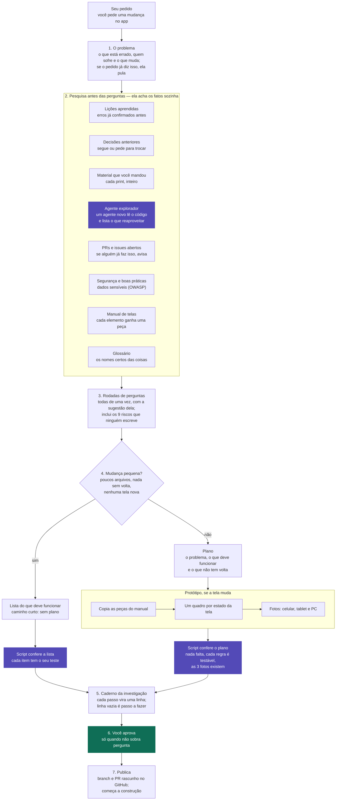
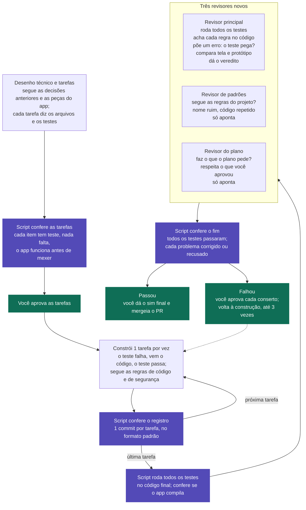

# cass — pensar antes de fazer, construir com prova, conferir antes de confiar

Quinze skills para trabalhar com IA no Claude Code e no Codex. Cada skill resolve um momento em que
a IA costuma errar: ela começa a construir antes de entender o pedido, diz "pronto" sem testar ou
inventa um número de pesquisa. Você pode chamar cada skill sozinha.

## Por onde começar

| A sua situação | Caminho |
|---|---|
| Você sabe o que quer mudar | `/cass:spec-plan` |
| Você ainda não sabe o que pedir | `/cass:ask-me` → `/cass:spec-plan` |
| Você precisa de dados com fonte | `/cass:ask-me` → `/cass:search` → `/cass:spec-plan` |
| Você tem um problema difícil, sem resposta clara | `/cass:auto-think` → `/cass:spec-plan` |

O fluxo de código é `/cass:spec-plan` → `/cass:implementar` → `/cass:build-review`. Uma feature
inteira vai num PR só. Cada skill chama a próxima sozinha depois do seu sim.

Nos desenhos, as caixas roxas são scripts ou agentes que conferem o trabalho, e as caixas verdes
são as paradas para o seu sim.

---

## O fluxo de código

### 1. Planejar — `/cass:spec-plan`

A skill transforma o seu pedido num plano aprovado. Ela pesquisa o código antes de perguntar, faz
as perguntas em rodadas e, quando uma tela muda, mostra um protótipo com fotos antes do seu sim.



O protótipo não é feito quando a mudança só troca um texto ou uma cor, esconde algo ou conserta
um defeito visual. Com o protótipo, as fotos aprovadas viram o modelo que a construção e a
revisão seguem.

[Instruções](skills/spec-plan/SKILL.md)

### 2. Construir e revisar — `/cass:implementar` e `/cass:build-review`

A `implementar` escreve as tarefas, pede o seu sim e constrói uma tarefa por vez. No fim, a
`build-review` chama três revisores novos, que não construíram nada.



No caminho curto (só a lista), não há desenho técnico nem tarefas: a construção começa direto.

[Instruções da implementar](skills/implementar/SKILL.md) · [Instruções da build-review](skills/build-review/SKILL.md)

### O que cada script confere

Os scripts leem os arquivos da feature. Eles não julgam o código. Se um script falha, o agente
para e corrige antes de continuar.

| Script | Quando roda | O que confere |
|---|---|---|
| `validate_plan.py` | antes de mostrar o plano | cada critério pode ser testado, nenhuma seção falta, cada tela tem a linha do protótipo e as 3 fotos |
| `validate_checks.py` | antes de qualquer código | cada item de uma lista tem a sua prova; com `--execute`, roda o build e confere o seu sim |
| `validate_tasks.py` | antes de mostrar as tarefas | cada tarefa diz os arquivos, os testes e quando fica pronta; nenhuma depende de uma tarefa posterior |
| `check_commit.py` | antes de cada commit | a mensagem segue o formato padrão (`feat:`, `fix:`...) |
| `check_proofs.py` | antes dos revisores e depois de cada conserto | roda cada teste no commit atual, mais o build, os tipos e o lint |
| `validate_verification.py` | antes de dizer "pronto" | todas as provas passaram no último commit e cada achado foi corrigido ou recusado por você |

O limite deles: eles não pegam um teste que passa pelo motivo errado. Quem pega é o revisor
principal.

### Construir com o Codex — `/cass:gpt-implementar`

Faz o mesmo trabalho da `implementar`, mas o Codex escreve o código e o Claude confere as provas.
No sim do plano, a resposta "Sim, com skill gpt-implementar" escolhe este caminho.

[Instruções](skills/gpt-implementar/SKILL.md) · [Operador Codex](skills/gpt-implementar/references/codex-runner.md)

---

## As outras skills

| Skill | Para quê |
|---|---|
| `/cass:ask-me` | Faz uma entrevista até o seu pedido ficar claro e entrega um pedido pronto para o agente: o que fazer, o que não fazer e quando parar. |
| `/cass:auto-think` | Estuda um problema difícil e volta com a opção recomendada e as alternativas. Não executa nada. |
| `/cass:search` | Pesquisa em que cada número volta com a página, a frase e a data. O que ela não acha, ela diz que não achou. |
| `/cass:gpt-optimizer` | O GPT tenta derrubar uma decisão já tomada. Volta com Seguir, Ajustar ou Bloquear. |
| `/cass:design-critique` | Avalia uma tela: usabilidade, hierarquia, consistência e acessibilidade, com a gravidade de cada problema. |
| `/cass:issue` | Salva um trabalho para depois como issue no GitHub, com contexto suficiente para outra pessoa assumir. Também quebra um plano em tarefas. |
| `/cass:oq` | "O quê?": quando você não entende a última resposta, pede para a IA reformular em palavras simples, sem acrescentar conselhos. |
| `/cass:handoff` | Escreve um documento de passagem e um texto para colar numa conversa nova. |
| `/cass:aprender-com-a-sessao` | Depois de uma sessão de código, mostra onde o ambiente fez a IA errar e sugere ajustes. Você decide o que aplicar. |
| `/cass:otimizar-arquitetura` | Dá um vocabulário único para reorganizar o código em módulos mais fáceis de testar. |
| `/cass:writin-skills` | Cria, ajusta e testa skills: primeiro mostra a falha sem a mudança, depois prova a correção. |

---

## Instalar

**1. O plugin.** No Claude Code, uma linha por vez:

```
/plugin marketplace add cassianodiniz/cass
/plugin install cass@cass
```

Reinicie o Claude Code. As skills aparecem como `/cass:spec-plan`, `/cass:ask-me` etc.

**2. As ferramentas de fora.** Um comando no terminal instala o que é automático (Mac e Linux;
no Windows, pelo Git Bash):

```bash
curl -fsSL https://raw.githubusercontent.com/cassianodiniz/cass/main/install.sh | SKIP_PLUGIN=1 bash
```

Duas coisas ficam com você, porque dependem de conta: o `codex login` e a conta no Exa. Detalhes
no [INSTALL.md](INSTALL.md).

### Do que cada skill depende

| Ferramenta | Quem usa |
|---|---|
| Claude Code | todas |
| Codex CLI 0.169 ou mais novo, com `codex login` | `gpt-implementar`, `gpt-optimizer`, `auto-think` e a revisão da `writin-skills` |
| Exa | `search` |
| git | `implementar`, `gpt-implementar`, `build-review` e `handoff` |
| Python 3 | os scripts de `spec-plan`, `implementar` e `build-review` |
| GitHub CLI (`gh`, logado) | `spec-plan` (branch e PR rascunho), `build-review` e `issue` |
| Um navegador que o agente controla | as fotos do protótipo e da revisão |

---

## Autoria e créditos

**Autoria:** Cassiano Diniz. **Co-autoria:** Tech Club, que deu insumos para as skills de
construção e de revisão. Histórico em [CHANGELOG.md](CHANGELOG.md). Auditoria desta versão em
[docs/auditoria-plugin.md](docs/auditoria-plugin.md).

- `spec-plan`, `implementar` e `build-review` adaptam o fluxo `tlc-spec-driven` e o núcleo
  `tlc-spec-lean` de **Felipe Rodrigues (Tech Leads Club)**, sob CC BY 4.0, e usam material de
  **Matt Pocock**, sob MIT. Créditos em cada pasta: [spec-plan](skills/spec-plan/CREDITS.md),
  [implementar](skills/implementar/CREDITS.md), [build-review](skills/build-review/CREDITS.md).
- `otimizar-arquitetura` é a skill `codebase-design` de **[Matt Pocock](https://github.com/mattpocock/skills)**,
  sob MIT ([licença](skills/otimizar-arquitetura/LICENSE)).
- `aprender-com-a-sessao` é a skill `retro` de **Matt Pocock**, com o guia `writing-for-agents`,
  sob MIT ([licença](skills/aprender-com-a-sessao/LICENSE)).
- `issue` adapta material de **Matt Pocock**, sob MIT ([licença](skills/issue/LICENSE)).
- As regras de segurança da `spec-plan` usam a **OWASP ASVS 5.0**
  ([referência](skills/spec-plan/references/skills/owasp-asvs)).
