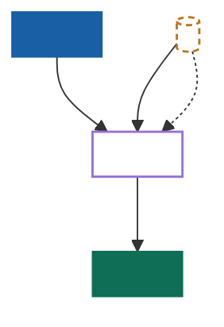

# Plan

The one artifact a human reads to understand the work and object to it, before any claim carries a test selector. Two halves: what must be true, then what is being built. They share a file because they are one review: deriving the checks in the same pass that decides the shape produces checks that ratify whatever was already assumed.

Skip this file when the change is under roughly three files, with no one-way door and no prototype ([prototype.md](prototype.md)); write the intent paragraph straight into `checks.md`.

Every question to the user - what comes before the first one, when to ask and when to stop - follows [investigate.md](investigate.md). This file is what the plan holds.

An open architectural bet (job or request cycle, which of two architectures) is settled first in an ADR, RFC or spike and linked. This file records the shape that won.

# What must be true

## Recover the problem

Write the problem in the present tense with no solution inside it: what is true today that should not be, who pays for it, what it costs. "We have no Stripe integration" is the absence of an answer; "anyone evaluating the product has to enter a card first" is a problem someone can disagree with. Copy the evidence the source gives literally, or say it gives none.

Close the section with what is different for a user when this ships. That line is the goal the checks are held against.

## Walk the surfaces

Each kind of surface carries the same decisions every time. Walk the row for every surface this feature exposes; each item becomes a criterion, an existing behaviour you name, or nothing to decide. For a screen, write the walk in the plan's `## Screen states` table: one table per screen, one row per state, with the account, the data and the width that reach it; each row lands on a criterion, an existing behaviour you name, a question, or `nothing to decide - <why>`. An account gets one row for each data state in which it could see something different. The Verifier tests every row, so a state the table leaves out is a state nobody checks.

Identify the pieces: before you draw a screen or write its criteria, read in full the design manual's list of existing pieces (the file `AGENTS.md` or `CLAUDE.md` names for screens, or a `DESIGN.md`). What existing piece can each element of the screen use? Write it on the screen's `**Pieces:**` line: the element, the piece and its variant, and the location of the piece's file. An element with no existing piece is a new piece, a gray area of [investigate.md](investigate.md). Once approved, the new piece is built once as a shared piece and added to the manual before any screen uses it. A reference from another product, sent for its look, uses the pieces the same way; its elements are never rebuilt by hand inside the screen, and its code is never copied.

| Surface | The decisions it always has |
| --- | --- |
| a screen or view | each account that opens it - owner, team member without the permission, patient - and what each one sees while the data is in each of its states, such as work another account has not saved yet or data saved before the current rule (who?); empty, loading, error and unauthorised states; the largest value and the longest text each field takes (how much?); ordering of content; the window widths it must work at - the references' sizes, or asked when no reference settles it; what a long list or a wide table does - what scrolls and what stays in view; what a destructive action confirms; what each control does when used - who acts, which control, what the page shows afterwards; data saved before the current rule (when?); two tabs or two clicks at once (at the same time?) |
| an API or webhook | response shape, error shape with its codes, who may call it, versioning, rate limit behaviour |
| a command or scheduled task | output format, every flag and its default, exit codes, what it prints when it fails halfway |
| a document or copy | structure, tone, depth, what the reader does next |
| a collection being organised | grouping, naming, ordering, duplicates, the exception that does not fit |

The two that hide best: the error shape (decided by whoever writes the first handler) and the empty state (invisible until a new account opens the page). State, persistence and contracts are the nine dimensions in [checks.md](checks.md), not this list.

## Write the criteria in EARS

| Pattern | Template | Use for |
| --- | --- | --- |
| Ubiquitous | The [system] SHALL [response] | always-on invariants |
| Event-driven | WHEN [trigger] THEN the [system] SHALL [response] | a response to a discrete trigger |
| State-driven | WHILE [state] the [system] SHALL [response] | behaviour that holds during a state |
| Optional-feature | WHERE [feature is present] the [system] SHALL [response] | behaviour behind a flag |
| Unwanted-behaviour | IF [condition] THEN the [system] SHALL [response] | errors, invalid input, timeouts |
| Complex | WHILE [state], WHEN [trigger] the [system] SHALL [response] | combinations |

One requirement per criterion, with a concrete value - a status code, a field, a bound - never "quickly" or "properly". Edge cases are criteria, usually IF/THEN.

**A control owes a gesture.** Every control this feature puts in front of a user owes a criterion that names who acts, which control, and what the page shows afterwards. A screenshot shows the button, never what it does. Name the use as it really happens: several files where several are allowed, editing what exists and not only creating it.

**A screen with a binding source points at it.** Each screen or state the source draws gets one criterion naming the gesture that reaches it and its capture files - the image, and the structural capture beside it where there is one:

```
27. WHEN bob uses "Add cover" THEN the system SHALL show the dialog in
    `.specs/features/<f>/captures/cover.png` (`.specs/features/<f>/captures/cover.aria.yml`)
```

The builder matches the image for composition and look. Do not retype the screen into criteria; add criteria only for what the source cannot show: what a control does, states nobody captured, the rules behind a form. Labels and sentences a capture draws are copied from it, character for character, in criteria and Assumptions alike; a state the capture does not draw reuses them, not a paraphrase. Its sample data - names, quantities, dates - is the data its `## Screen states` row names, so the builder and the Verifier reach the same picture. A binding source is also the measure of scope: build what it draws, minus what `## Differences from the source` lists.

**What binds.** The prototype's photos bind: they are the captures, in `captures/` ([prototype.md](prototype.md)). A capture, screenshot, design frame or live site that comes with the request is a reference: the prototype follows it, held to the project's design manual. Export each frame or state of it, open ones included, to `.specs/features/<f>/references/`, keep the link in `Sources` with the date, show it there, ``, and ask for the files as a `blocks` question when you cannot reach it. Each capture's `Sources` line shows the image, so whoever approves the plan sees the screen beside the criteria.

**A screen change gets a prototype**, as [prototype.md](prototype.md) says. A change with no prototype gets outcomes, not layout: say what a user can see and do, never where things sit. Layout is held to the project's design manual: the file `AGENTS.md` or `CLAUDE.md` names for screens, or a `DESIGN.md`. When the project has one, add one criterion per changed screen, `The <screen> SHALL follow <manual path>: <rules>`, quoting the manual's rules, with their values, for the pieces that screen uses: space between rows, row height, text styles, control sizes. A value a screen needs and the manual does not have is a gray area.

**A backend criterion is a rule with examples under it.** One example is the strong case - the boundary, or the input where an implementation fitted to the obvious sample breaks.

```
12. IF a coupon has expired THEN checkout SHALL reject it with 422 `coupon_expired`
    - expired yesterday → 422; expires today at 23:59 → accepted; no expiry date → accepted
```

**One run must settle it.** A percentile, an average or an uptime is a service target, not a criterion. Split it: the behaviour is the criterion, the target goes to observability.

**A guarantee that something will not happen needs a mechanism.** "A retry does not create a second subscription" points at the code that enforces it, or becomes a `Landing` door. Without one it is a question.

# What is being built

Three sections, each with a rule about what stays out: no component catalogue, no columns, no types. Those are reversible and settled in design.md after the yes.

## Shape - the path and what it disturbs

Open with one sentence on what this reuses instead of duplicating, and one on where the rules that change an outcome run: in a layer the repo's tests can reach, as its `AGENTS.md` or test docs say. Filtering, searching, sorting and counting decide what a user sees, so they are rules too, not presentation.

**The path.** One numbered line per hop: what enters, which module it crosses, what it hands on, what persists or goes out at the end. Name only modules that exist today, marked `(exists)`, or that a `Landing` door creates, marked `(door <n>)`; a new module with no door is `(new)` and its placement is design.md's. `single module - <name>` is complete.

**The drawing.** The person approving the plan reads a drawing before a list, so draw the path in mermaid, in the user's words: a `flowchart` of what happens for the people involved, with screens and people as the user knows them, before → after when a screen changes, and no module, table or code names. Draw it top to bottom. A box is a thing (a person, a screen, an outside service the user knows by name) in at most four words; what happens goes on the arrow. Colour and line style follow the template below and nothing else is coloured. Use only behaviors the list and the criteria already state. The list says which module does each hop; the drawing shows what the people see. Both stay true through the build.

**The data.** An `erDiagram` of the entities this reads or writes and how they relate, then one line, `New: <entities and relations this adds>` (`New: nothing - read only` is complete). No attribute blocks. `Data: none - <why>` when nothing stored is touched. Then one line, `Sensitive data: <the personal or sensitive data this stores, and where>`, as [seguranca.md](seguranca.md) asks (`Sensitive data: none` is complete).

**States**, only when an entity or a screen moves through states: a `stateDiagram-v2` with each transition and what triggers it. A missing transition shows in a drawing where it hides in a list of criteria.

**Changes underneath.** A table of what already exists and changes: a domain term that changes meaning (name who branches on it today), stored data (backfill, migrate on read, or nothing), and each reader that will see the new data. Each reader named gets a criterion or an `Out of scope` row. It also names each rule another area owns that this relies on: where it lives, and whether it has one entry or is written in several places (name each). Each rule written in several places is a question to the user; the answer becomes a criterion or an `Out of scope` row.

When stored data changes, the `erDiagram` also carries the one-way constraints `Landing` settled.

## Surface - the signature

Only a route this adds or whose signature changes: route, what goes in, what comes out, statuses, and who may call it. The statuses include what a caller who may not call gets (redirect, 401, 403 or 404); `Who: anyone` owes none. No check numbers here. `None - nothing consumed outside` is complete.

## Landing - the one-way doors

A door is one-way when reversing it costs more than a refactor: a persisted schema, a contract someone consumes, a new dependency, a backfill, a pattern the codebase does not have yet. Each row gives the literal shape the next person copies and the alternative rejected, with the property that disqualified it. Scope and rules with no persisted mechanism are not doors. Identifier width, uniqueness, nullability over a populated table and a field a consumer binds to are doors. `None - <why nothing here is one-way>` is complete. A door that reaches past this feature also goes in `.specs/STATE.md` `## Decisions` ([memory.md](memory.md)).

## Gate Check Commands - the complete test battery

**Read project quality/testing guidelines (ALWAYS, before anything else).**

Before sampling tests or inferring anything, scan the project for documented quality and testing standards. Stack-agnostic sources to check (illustrative, not exhaustive):

- Agent/AI convention files, if the repo has any: `AGENTS.md` (the vendor-neutral standard) and any tool-specific rules file or rules directory the project happens to use
- Contributor guides: `CONTRIBUTING.md`, `docs/` (testing, quality, or standards subdocs), README testing section
- Tool configuration: coverage thresholds in the test runner config (e.g., `jest.config.*`, `vitest.config.*`, `pytest.ini`, `.nycrc`, `Makefile` coverage targets, CI coverage gates)

**Decision:**

- **Existing tests in the repo** → infer the gate commands by sampling the codebase.
- **No tests at all** → ask the user: "What test types will this project use (unit / integration / e2e / none)? What commands run them?"

**Discover commands from the repo.** Do NOT invent commands and do NOT assume an ecosystem. Read the project's own build/task manifests, test config, and CI workflows to extract the actual commands - for example: `package.json` / `project.json` (JS/TS), `Makefile`, `pyproject.toml` / `tox.ini` / `pytest` (Python), `Cargo.toml` (Rust), `go test` invocations (Go), `pom.xml` / `build.gradle` (Java/Kotlin), `Gemfile` / `Rakefile` (Ruby), `composer.json` (PHP), `.github/workflows` / `.gitlab-ci.yml`. The list is illustrative; detect what this repo actually uses. Capture the **linter/formatter** command too (e.g. the configured `lint`/`format`/`typecheck` script, or a `.pre-commit-config`, `.golangci.yml`, `ruff`/`eslint`/`biome` config) - the Build gate runs it alongside the tests.

Name what each row needs running (the app server, the functions server, the local database) so the build and the review start them. Never invent a suite for a family the repo does not have.

**Render this section verbatim into plan.md** (into checks.md when there is no plan):

```markdown
## Gate Check Commands

> Generated from codebase - confirm before Execute. Guidelines found: [list files, e.g. `AGENTS.md`, `jest.config.ts` - or "none - strong defaults applied"].

| Suite | Command | Needs running | Gate level |
| ----- | ------- | ------------- | ---------- |
| [suite] | [command] | [service, or nothing] | [quick / full / build] |
```

Mark each suite's `Gate level`: quick - after slices with unit tests only; full - after slices with e2e/integration tests; build - after config/entity-only slices. Each level also runs the suites of the levels below it.

The whole table runs in the independent review (with skill `build-review`). The user confirms it with the plan's approval; they are not asked to choose tests. `validate_plan.py` fails a plan with no table or with a suite row with no command.

# Before presenting

```bash
python3 <spec-plan>/scripts/validate_plan.py <feature>
```

It checks the structure. What it cannot see stays yours: a hop marked `(exists)` only stands if that module already does what the criteria assign it. And read the request again, one sentence at a time: each one lands on a criterion, an `Out of scope` row or an open question. A sentence that lands nowhere is the requirement that goes missing, and nobody downstream reads the request again.

Every unresolved decision is a criterion, an `Assumptions` row, or an open question marked `blocks`, `blocks go-live` or `open`.


## Template: `.specs/features/<feature>/plan.md`

`````markdown
# <Feature>

**Approved**: <written when the user approves - YYYY-MM-DD - user: "their words">

## Problem

<Present tense, no solution inside it: what is true today, who pays, what it costs. The evidence
the source gives, or a note that it gives none.>

<What is different for a user when this ships.>

## Shape

<One sentence: what this reuses instead of duplicating. One sentence: where the rules that change an outcome run, in a layer the repo's tests reach.>

1. <what enters> -> `<Module>` (exists) - <what it does, what it hands on>
2. `<Module>` (exists) - <what it does>, persists `<Entity>` (door <n>)
3. `<Module>` (new) - <what it decides>
4. out: `<response>`, and `<Module>` (exists) reads `<field>` on the next request



<More than five boxes: group them in one `subgraph` per place, each with `style <id> fill:transparent`. Five or fewer: no `subgraph`.>

**Changes underneath**

| Front | What changes |
| --- | --- |
| domain | `<Name>` meant <x>, now means <y> - <who branches on it today> |
| stored data | <backfill now / migrate on read / nothing to migrate> |
| readers | <screen or job that shows the new data> |
| rules | `<rule another area owns>` lives in `<file:line>` - <one entry / written in: each place> |

```mermaid
erDiagram
    <Entity> ||--o{ <Entity> : "<verb>"
```

New: <entities and relations this adds, or `nothing - read only`>. One-way constraints: <field>
unique (door <n>).

Sensitive data: <the personal or sensitive data this stores, and where; or `none`>

<Only when something moves through states:>



```mermaid
stateDiagram-v2
    [*] --> <State>
    <State> --> <State> : <trigger>
```

## Surface

| Route | In | Out | Status | Who |
| --- | --- | --- | --- | --- |
| `<METHOD> /<path>` | `<field>` | `<field>` | `<code>`, `<denied code>` | <who may call it, and what the rest get> |

## Landing

| One-way door | Literal shape | Alternative rejected |
| --- | --- | --- |
| <what> | <the literal a reader copies> | <the option, and the property that disqualified it> |

- Nothing else in this change is hard to reverse

## Screen states

### <screen>

**Pieces:** <element> - `<piece> <variant>` (`<file of the piece>`); <element> - new piece - <capture>, approved in AD-NNN

**Prototype:** `prototype/<screen>.html`, or none - <element> edited in place

| State | Account, data and width | Criterion |
| --- | --- | --- |
| <state from the walk> | <who opens it, the data that reaches it, the width> | <criterion number, or `nothing to decide - <why>`> |

## Criteria

### S1: <slice - the outcome someone can watch> (P1)

<One line: the outcome this slice is.>

**Acceptance Criteria**

1. WHEN <trigger> THEN the system SHALL <observable outcome with the concrete value>
2. IF <undesired condition> THEN the system SHALL <response>
   - <example> → <result>; <the strong case> → <result>
3. WHEN <who> <gesture> THEN the system SHALL show the <screen> in `<image>` (`<structural capture>`)

## Gate Check Commands

> Generated from codebase - confirm before Execute. Guidelines found: <files, or "none - strong defaults applied">.

| Suite | Command | Needs running |
| --- | --- | --- |
| <suite> | `<command>` | <service, or nothing> |

## Out of scope

| Excluded | Why |
| --- | --- |
| <capability> | <reason> |

## Assumptions

| Assumption | Chosen default | Rationale | Confirmed? |
| --- | --- | --- | --- |
| <ambiguity> | <what we will do> | <why> | y/n |

**Open questions:** none - all resolved or logged above.

## Differences from the source

<Only when a source binds. Every way the product departs from what the source draws, each one
approved by the user.>

| Source shows | Product shows | Confirmed |
| --- | --- | --- |
| <label, control or state in the capture> | <what the product shows instead, or nothing> | y - <AD-NNN holding the question and the answer> |

<Or:> None - the product matches the source

## Investigation

| Step | Landed |
| --- | --- |
| Problem | |
| Confirmed lessons | |
| `.specs/STATE.md` decisions | |
| References in `references/`; prototype and its photos in `captures/` | |
| Explorer sub-agent | |
| Open PRs and issues | |
| Glossary | |
| seguranca.md | <`done - ASVS chapter files opened: <list>`, or `n/a - <why>`> |
| tanstack-query-best-practices | |
| coding-principles.md | |
| Surfaces walked | |
| Pieces, and each new piece | |
| Window widths | |
| 1 input validation | |
| 2 failure modes | |
| 3 idempotency and retry | |
| 4 authorization | |
| 5 concurrency and ordering | |
| 6 data lifecycle | |
| 7 external dependency failure | |
| 8 state transitions | |
| 9 observability | |
| Test battery | |

## Sources

- <ticket> - binding - <what it settles>
-  - binding - prototype
-  - reference - <what the prototype took from it>
`````

## Then confirm

When no question is left, present the plan and stop for the yes. Name `Shape`, any `Landing` door with a live alternative, and anything that changes existing data or a consumed contract. Ask for that yes with the local [approval message](approval-message.md). When the user approves, write `**Approved**: <YYYY-MM-DD> - user: "<their words>"` under the title; one the user did not give is never written, and `validate_checks.py` refuses to start without it. Then continue into [design.md](design.md).

## Notes

- P1 is a vertical slice, not a layer. Priority orders the work and never scales down verification.
- A criterion you cannot imagine a test for is not ready.
